<picture>
  <source media="(prefers-color-scheme: dark)" srcset="assets/banner-dark.svg">
  
</picture>

  
  
  
  

  PhD researcher at the <b>UWICORE Lab, Universidad Miguel Hernández de Elche</b> (Spain).
  I build perception and reasoning systems for <b>connected automated vehicles</b>: fusing onboard sensors with V2X data,
  catching the ghost objects that fusion creates with fine-tuned LLMs, and running it all as tested, reproducible pipelines.

  🎯 <b>Open to</b> &nbsp;AI Engineer · Robotics Engineer · MLOps Engineer roles

## What I do

<table>
<tr>
<td width="33%" valign="top">

**🧠 AI Engineering** 
LLMs as reliable system components: agents with guardrails, LoRA/QLoRA fine-tuning, RAG, evaluation harnesses, GNNs.

</td>
<td width="33%" valign="top">

**🤖 Robotics** 
Perception for autonomous driving: multisensor and V2X fusion, Kalman tracking, data association, SUMO and CARLA simulation, deep RL.

</td>
<td width="33%" valign="top">

**⚙️ MLOps / LLMOps** 
Research code that survives production: Docker sandboxes, CI/CD, DVC and MLflow, large sweeps on GPU servers and HTCondor.

</td>
</tr>
</table>

## Featured work

<table>
<tr>
<td width="50%" valign="top">

### OCTOPUS

 

A simulator for onboard and V2X data fusion that runs online with SUMO: occlusion-aware sensing, Kalman tracking, Collective Perception Messages, S2S/S2G fusion and parameter sweeps on HTCondor.

Python · SUMO · DuckDB · mypy strict · pytest

</td>
<td width="50%" valign="top">

### AgentEnvForge

 

Define a coding task once, run any AI agent against it in a locked-down Docker sandbox, grade it with tests the agent never saw, and reproduce every run. Batch experiments with parallel workers.

Python · Docker · Typer · Pydantic · GitHub Actions

</td>
</tr>

<!-- Hidden until finished: move a <td> block above (or delete these comment markers) to show it again.
<tr>
<td width="50%" valign="top">

### LLM Ghost Object Mitigation

 

Fine-tuned LLMs (LoRA/QLoRA) act as verifiers inside a V2X cooperative-perception pipeline, filtering, repairing and preventing ghost objects at three intervention points. Benchmarked against gradient-boosting and GNN policies.

Python · PyTorch · PEFT · Ollama · scikit-learn

</td>
<td width="50%" valign="top">

### CoPerceptionOps

 

Data platform for cooperative perception: a DVC pipeline turns ~196 GB of raw OPV2V into a versioned Parquet + DuckDB feature store with difficulty-stratified benchmark splits (226K objects, zero ETL failures).

Python · DVC · DuckDB · Polars · Pydantic

</td>
</tr>
<tr>
<td width="50%" valign="top">

### E2E Driving under Perception Errors

 

Closed-loop study in CARLA of how ghost and missed objects degrade end-to-end driving models (MindDrive, TransFuser): Bench2Drive routes, collision forensics, phantom-braking checks and annotated driving videos.

Python · PyTorch · CARLA · Bench2Drive

</td>
<td width="50%" valign="top">

### Agentic NFV/SDN Orchestration

A safety-wrapped agent for a 5G industrial drone network: an LLM proposes where to compute each task, while guardrails, a network digital twin, a validator and a critic decide what is applied. Compared head-to-head with classical schedulers.

Python · LangGraph · Ollama · FastAPI

</td>
</tr>
-->

</table>

🔒 The code for these projects is private for now. I'm happy to walk you through either of them.

## Toolbox

  
   
  Also: Hugging Face Transformers · PEFT · LangGraph · Ollama · MLflow · DVC · DuckDB · SUMO · CARLA · HTCondor

## Selected publications

- [**Fusion or Confusion? Potential and Challenges in Fusion of Onboard Sensors and V2X Data in Cooperative Perception**](https://ieeexplore.ieee.org/abstract/document/11230764/) · *IEEE CSCN 2025*
- [**How the Fusion of Onboard Sensors and V2X Data can improve (or not) the Cooperative Perception of Connected Automated Vehicles**](https://ieeexplore.ieee.org/abstract/document/11174443/) · *IEEE VTC 2025-Spring*
- [**Disaster Relief in Industrial IoT: UAV Trajectory Design and Resource Allocation in 6G Non-Terrestrial Networks**](https://ieeexplore.ieee.org/document/10468637) · *IEEE Open Journal of the Communications Society, 2024*

→ [All publications on Google Scholar](https://scholar.google.com/scholar?q=Amir+Mohammadisarab)
